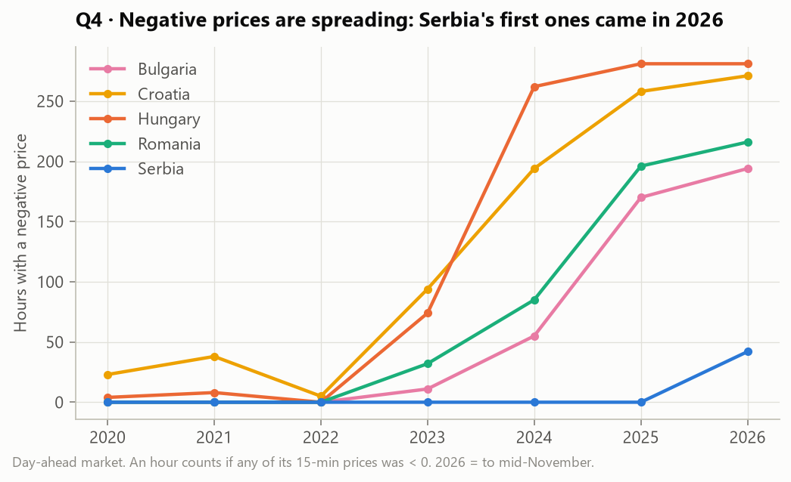
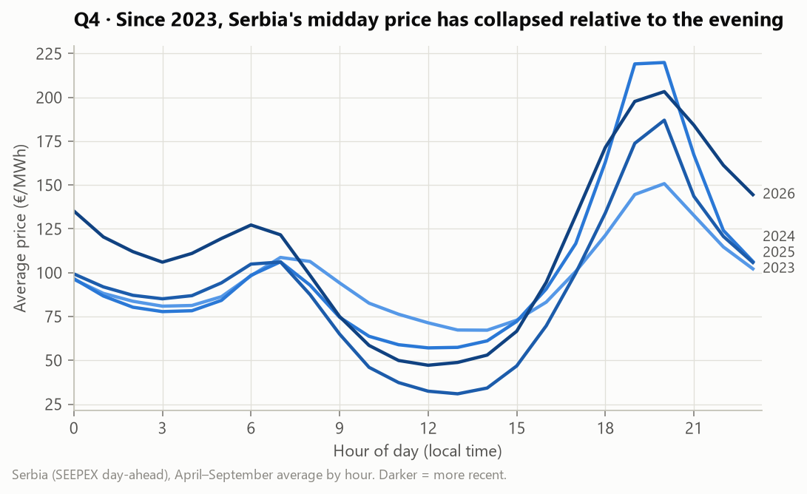
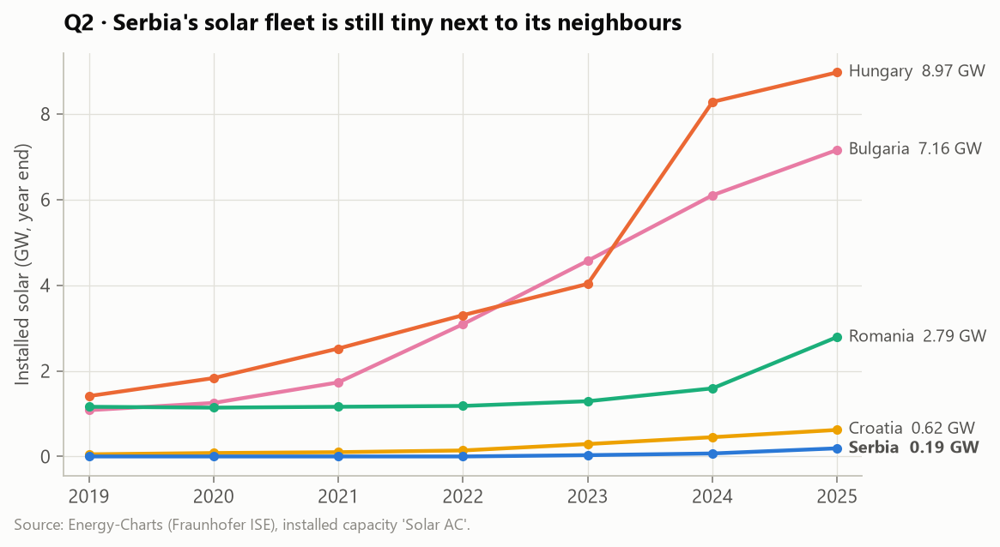
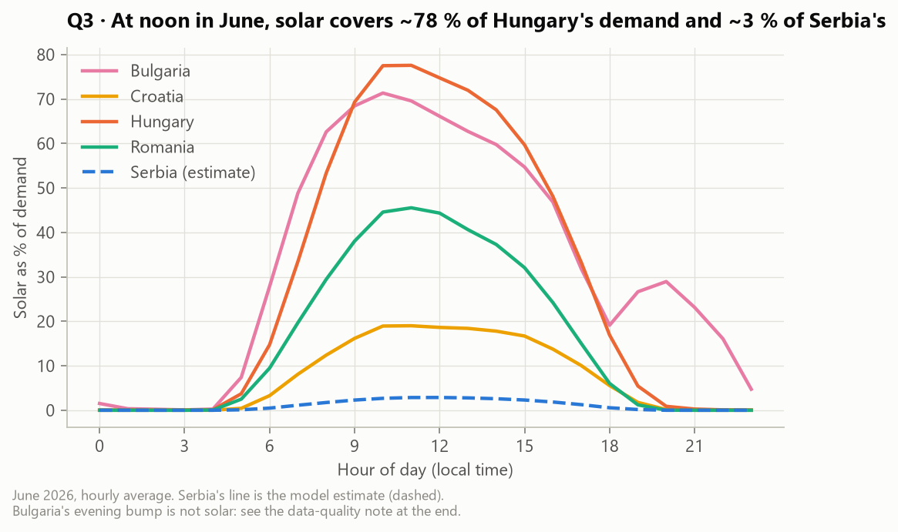

# ☀️ Solar PV Analytics — Serbia vs. its neighbours

An end-to-end data analytics project: **public energy APIs → Python → PostgreSQL → Power BI**.
It looks at solar photovoltaic (PV) energy in South-East Europe, with **Serbia** as the focus and
Hungary, Romania, Croatia and Bulgaria as benchmarks.

## Key findings

1. **Serbia's day-ahead price went negative for the first time on 10 May 2026, and the cause is imported.**
   In Serbia's 42 negative-price hours, Serbian solar covered only ~3 % of demand (estimated), while at least one neighbour
   was negative in 39 of them and all four in 35. The coupled regional market passes the neighbours' midday solar glut into Serbian prices.
2. **The regional solar boom is already reshaping Serbian prices.** Midday power used to be ~20 % cheaper than the evening
   (2020–2022). Since 2024 it has been 70–80 % cheaper. A Serbian solar plant now earns ~63 % of the average price (estimated capture rate).
3. **Serbia's solar fleet is tiny but growing fast:** 0.03 → 0.19 GW (2023→2025), 47× smaller than Hungary's.
   Home-grown negative prices would need ≈ 4 GW, which is 2029–2033 under fast growth and decades at today's pace.
4. **For a rooftop owner, orientation matters ~3× more than city.** Serbian cities are within 7 % of each other
   (Niš best, 1,281 kWh/kWp). East/west roofs lose ~20 %. A 6 kWp system pays back in ~10–11 years under the stated assumptions.
5. **Serbia's hourly solar output had to be estimated** (it isn't published). A weather model trained on four neighbours
   predicts a held-out country with hourly R² 0.94 and ~7 % monthly error.
6. **Data-quality catch:** Bulgaria's official "solar" series contains up to 1.4 GW of output *after sunset* from 2025
   (10 % of its 2026 solar), most likely batteries reported as solar. Those years were excluded from model training.

| | |
|---|---|
|  |  |
|  |  |

➡️ **Full analysis with all charts and tables: [reports/findings.md](reports/findings.md)**

## Power BI dashboard

Six pages: overview · Serbia PV potential with a rooftop payback calculator · grid & neighbours · prices & negative hours ·
Serbia solar estimate · weather. Build guide, DAX measures and theme: [powerbi/](powerbi/README.md).

_Screenshots coming soon._

## Business questions

| # | Question | Data |
|---|----------|------|
| 1 | **Where in Serbia is rooftop PV most worth it?** Yield (kWh/kWp), optimal tilt and payback by city | PVGIS |
| 2 | **How fast is Serbian solar growing compared with its neighbours?** | Energy-Charts installed capacity |
| 3 | **What does Serbia's hourly solar output look like?** Serbia publishes no hourly solar data, so it is *estimated* and the method is validated on countries that do | Energy-Charts + Open-Meteo |
| 4 | **How does solar affect electricity prices?** Midday price dip, capture price, negative-price hours, and *when Serbia could see negative prices* | Energy-Charts day-ahead prices |
| 5 | **How much does weather drive solar output?** | Open-Meteo + Energy-Charts |

## Tech stack

| Layer | Tools |
|-------|-------|
| Extract | Python (`requests`), REST APIs with throttling, retry and raw caching |
| Store / transform | PostgreSQL 17 (Docker), SQL (`raw` → `staging` → `mart` layers, CTEs, window functions) |
| Analysis | pandas, scikit-learn (gradient boosting), matplotlib |
| Visualisation | Power BI (DAX measures, star schema) |
| Quality | pytest, SQL data checks |

## Data sources (all free and public)

- [Energy-Charts API](https://api.energy-charts.info/) (Fraunhofer ISE): generation by source, load, day-ahead prices, installed capacity
- [PVGIS](https://joint-research-centre.ec.europa.eu/photovoltaic-geographical-information-system-pvgis_en) (EU Joint Research Centre): PV yield for any location
- [Open-Meteo Historical Weather API](https://open-meteo.com/en/docs/historical-weather-api): hourly irradiance, cloud cover, temperature

## Project structure

```
config/        settings (countries, cities, date range, PV economics assumptions)
src/extract/   API clients (throttling, retries, raw cache)
src/load/      raw JSON -> PostgreSQL (COPY)
src/estimate/  Serbia hourly solar model + leave-one-country-out validation
src/analysis/  runs the analysis SQL, draws charts, writes reports/findings.md
sql/           01 schema · 02 staging · 03 marts · 04 views · analysis/ (one query per question)
reports/       findings.md + figures/
powerbi/       dashboard (.pbix), DAX measures, screenshots
docs/          step-by-step guide and data dictionary
tests/         unit tests (pytest)
```

## How to run

Requirements: Python 3.12+, Docker Desktop, Power BI Desktop (for the dashboard).

```powershell
git clone https://github.com/DarioKonta/solar-pv-analytics.git
cd solar-pv-analytics
copy .env.example .env                  # then set PG_PASSWORD
python -m venv .venv
.\.venv\Scripts\pip install -r requirements.txt
docker compose up -d                    # PostgreSQL 17 on localhost:5432
.\.venv\Scripts\python -m src.pipeline  # download (~30 min first time, cached) -> load -> SQL -> estimate -> report
.\.venv\Scripts\python -m pytest        # tests
```

Rebuild everything from cached data only: `python -m src.pipeline --skip-extract` (~5 min).

## Step-by-step guide

See [docs/STEP_BY_STEP.md](docs/STEP_BY_STEP.md) for how every step was built, explained simply and then in detail.

## Author

**Dario Konta** · [GitHub](https://github.com/DarioKonta)
