# Findings

Generated by `python -m src.analysis.report` from the `mart` schema.

## Q1 · Where in Serbia is rooftop PV most worth it?

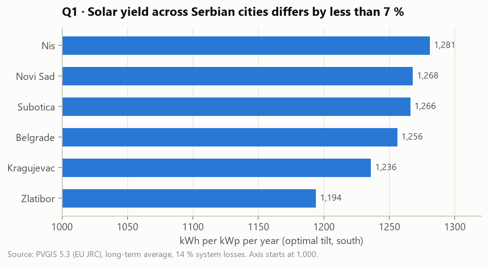

| City       |   kWh/kWp/yr |   Optimal tilt ° |   % vs best |
|:-----------|-------------:|-----------------:|------------:|
| Nis        |         1281 |               35 |         0   |
| Novi Sad   |         1268 |               37 |        -1   |
| Subotica   |         1266 |               37 |        -1.2 |
| Belgrade   |         1256 |               36 |        -1.9 |
| Kragujevac |         1236 |               36 |        -3.5 |
| Zlatibor   |         1194 |               36 |        -6.8 |

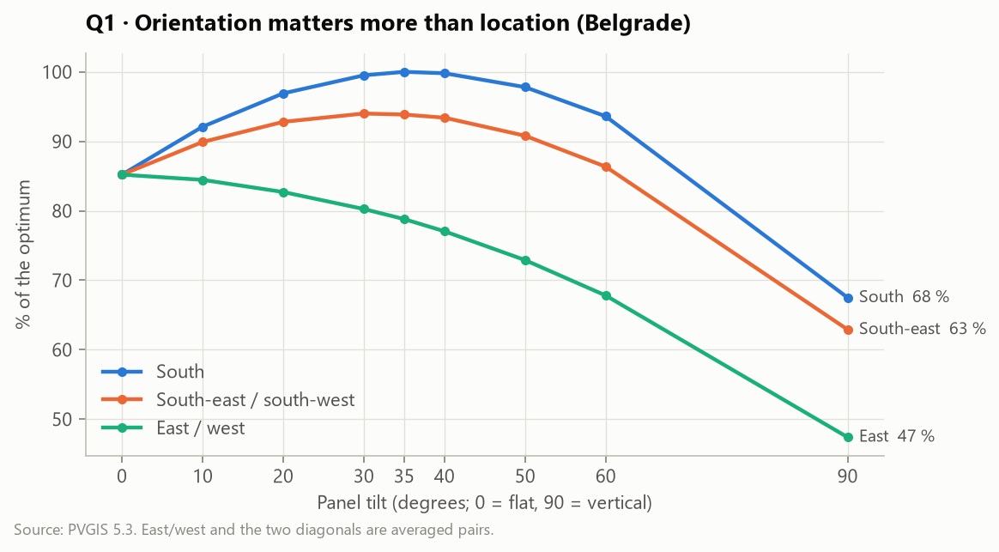

**Payback of a typical 6 kWp rooftop system**. Assumptions (editable in `config/settings.yaml`):
€900/kWp installed, 40 % self-consumed at €0.1/kWh,
the rest exported at €0.05/kWh, 0.5 %/yr degradation.

| City       |   kWh/year (6 kWp) |   Savings €/year |   Payback (years) |   Net gain over 25 y (€) |
|:-----------|-------------------:|-----------------:|------------------:|-------------------------:|
| Nis        |               7686 |              538 |              10.3 |                     7274 |
| Novi Sad   |               7608 |              533 |              10.4 |                     7145 |
| Subotica   |               7596 |              532 |              10.4 |                     7125 |
| Belgrade   |               7536 |              528 |              10.5 |                     7026 |
| Kragujevac |               7416 |              519 |              10.7 |                     6828 |
| Zlatibor   |               7164 |              501 |              11.1 |                     6413 |

**Takeaways**
- Niš and Vojvodina (Novi Sad, Subotica) are the best locations. Zlatibor, in the mountains, is the weakest, but the whole
  spread is under 7 %. Solar is viable everywhere in Serbia.
- **Orientation matters about 3× more than location.** A south-facing roof at 30–40° reaches ~99 % of the optimum.
  East or west at the same tilt loses ~20 %, and a flat roof ~15 %.
- With these assumptions a rooftop system pays back in about 10–11 years. The result depends mostly on how much
  electricity is used on site, because self-consumed kWh are worth twice as much as exported ones.

---

## Q2 · How fast is Serbian solar growing compared with its neighbours?

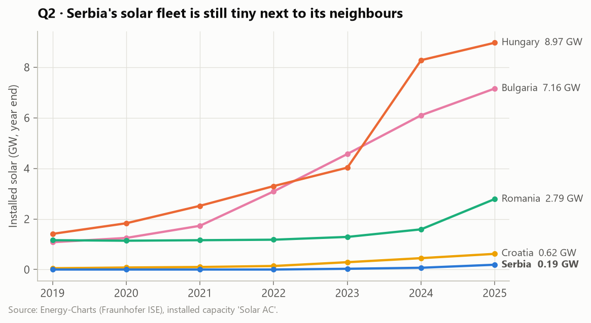

Installed solar capacity (GW, year end):

|   year |   Bulgaria |   Croatia |   Hungary |   Romania |   Serbia |
|-------:|-----------:|----------:|----------:|----------:|---------:|
|   2019 |       1.08 |      0.05 |      1.41 |      1.16 |     0    |
|   2020 |       1.25 |      0.08 |      1.83 |      1.14 |     0    |
|   2021 |       1.73 |      0.1  |      2.52 |      1.16 |     0    |
|   2022 |       3.09 |      0.14 |      3.3  |      1.18 |     0    |
|   2023 |       4.57 |      0.29 |      4.03 |      1.29 |     0.03 |
|   2024 |       6.1  |      0.45 |      8.28 |      1.59 |     0.07 |
|   2025 |       7.16 |      0.62 |      8.97 |      2.79 |     0.19 |

Solar output as % of electricity demand (Serbia = estimate from Q3; 2026 = January to mid-November):

|   year |   Bulgaria |   Croatia |   Hungary |   Romania |   Serbia |
|-------:|-----------:|----------:|----------:|----------:|---------:|
|   2020 |       3.91 |      0.46 |      3.72 |      2.31 |     0    |
|   2021 |       3.72 |      0.47 |      5.39 |      2.13 |     0    |
|   2022 |       4.38 |      0.52 |      7.1  |      2.43 |     0    |
|   2023 |       8.52 |      0.65 |     10.45 |      2.74 |     0.04 |
|   2024 |      13.37 |      1.3  |     13.11 |      3.84 |     0.14 |
|   2025 |      16.79 |      2.99 |     15.76 |      5.07 |     0.35 |
|   2026 |      22.98 |      5.03 |     19.35 |     10.01 |     0.76 |

**Takeaways**
- Serbia went from ~0 to **0.19 GW** (2023→2025: ×6). That is fast in relative terms,
  but the fleet is 47× smaller than Hungary's, 38× smaller than Bulgaria's,
  15× smaller than Romania's and 3× smaller than Croatia's.
- Solar covered about **0.3 %** of Serbian demand in 2025, against ~16 % in Hungary
  (Bulgaria's 2025–26 shares are overstated; see the data-quality note).

---

## Q3 · What does Serbia's hourly solar output look like?

Serbia publishes no hourly solar data, so it was **estimated** (method in `docs/STEP_BY_STEP.md`, Step 6).
Validation: hide one neighbour, train on the other three, predict the hidden one.

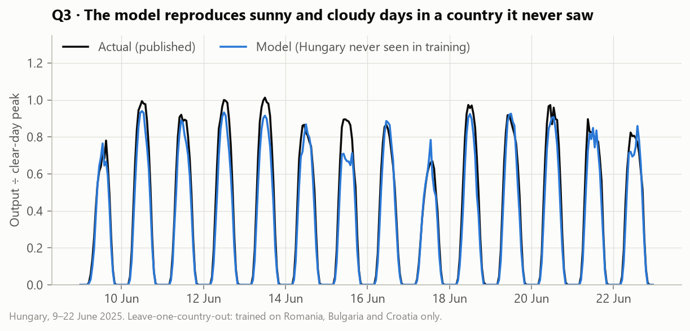

| Metric                  |   Baseline (irradiance only) |   Model |
|:------------------------|-----------------------------:|--------:|
| Daily error, nMAE (%)   |                        14.23 |   12.99 |
| Hourly R²               |                         0.94 |    0.94 |
| Monthly error, WAPE (%) |                         7.6  |    6.68 |
| Total bias (%)          |                         3.8  |    0.36 |

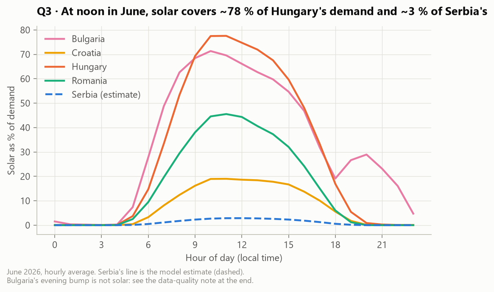

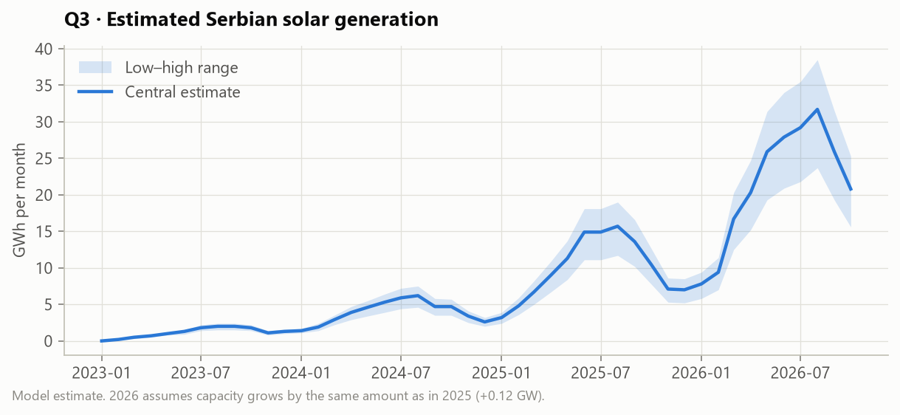

|   Year |   Estimate (GWh) |   Low |   High |
|-------:|-----------------:|------:|-------:|
|   2023 |               14 |    10 |     16 |
|   2024 |               48 |    35 |     58 |
|   2025 |              119 |    88 |    144 |
|   2026 |              216 |   161 |    262 |

**Takeaways**
- The weather model transfers well between countries (hourly R² ≈ 0.94, monthly error ≈ 7 %,
  bias +0.4 %).
- Serbian solar generated an estimated **~119 GWh in 2025** (range 88–144).
  Even at the June noon peak it covers only ~3 % of demand.

---

## Q4 · How does solar affect electricity prices, and when will Serbia see negative prices?

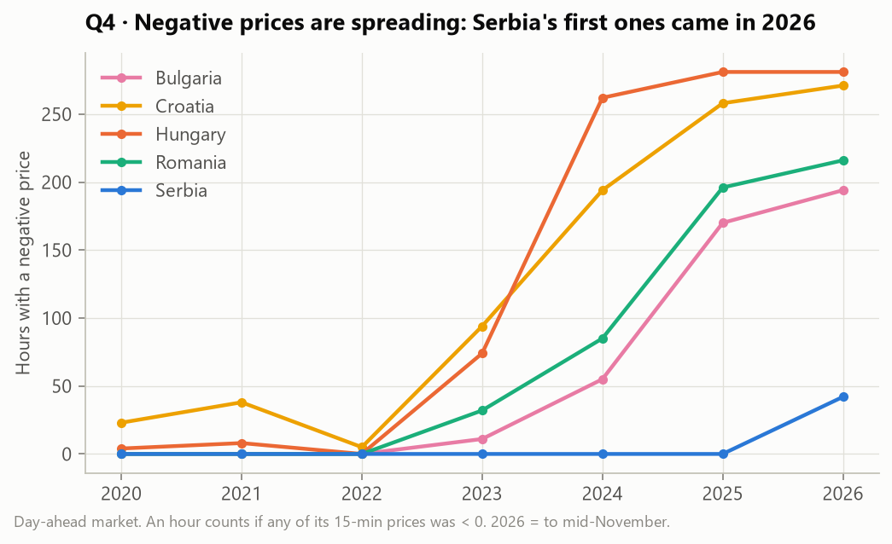

Hours with at least one negative price:

|   year |   Bulgaria |   Croatia |   Hungary |   Romania |   Serbia |
|-------:|-----------:|----------:|----------:|----------:|---------:|
|   2020 |          0 |        23 |         4 |         0 |        0 |
|   2021 |          0 |        38 |         8 |         0 |        0 |
|   2022 |          0 |         5 |         0 |         0 |        0 |
|   2023 |         11 |        94 |        74 |        32 |        0 |
|   2024 |         55 |       194 |       262 |        85 |        0 |
|   2025 |        170 |       258 |       281 |       196 |        0 |
|   2026 |        194 |       271 |       281 |       216 |       42 |

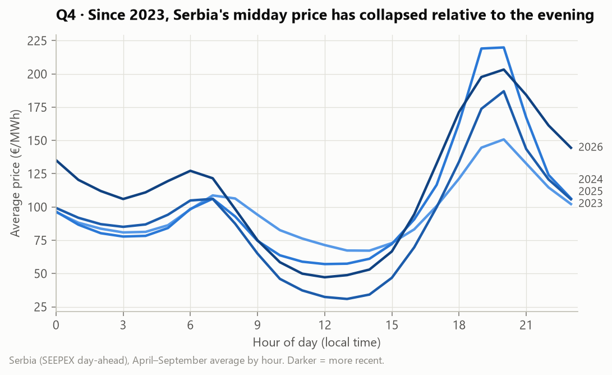

Serbia, April–September averages:

|   Year |   Midday (11–14 h) €/MWh |   Evening (18–21 h) €/MWh |   Midday discount % |
|-------:|-------------------------:|--------------------------:|--------------------:|
|   2020 |                     32.2 |                      42.7 |                  25 |
|   2021 |                     89.3 |                     110.2 |                  19 |
|   2022 |                    312   |                     387.2 |                  19 |
|   2023 |                     70.6 |                     137.4 |                  49 |
|   2024 |                     58.6 |                     192.3 |                  70 |
|   2025 |                     33.7 |                     159.6 |                  79 |
|   2026 |                     49.7 |                     189.2 |                  74 |

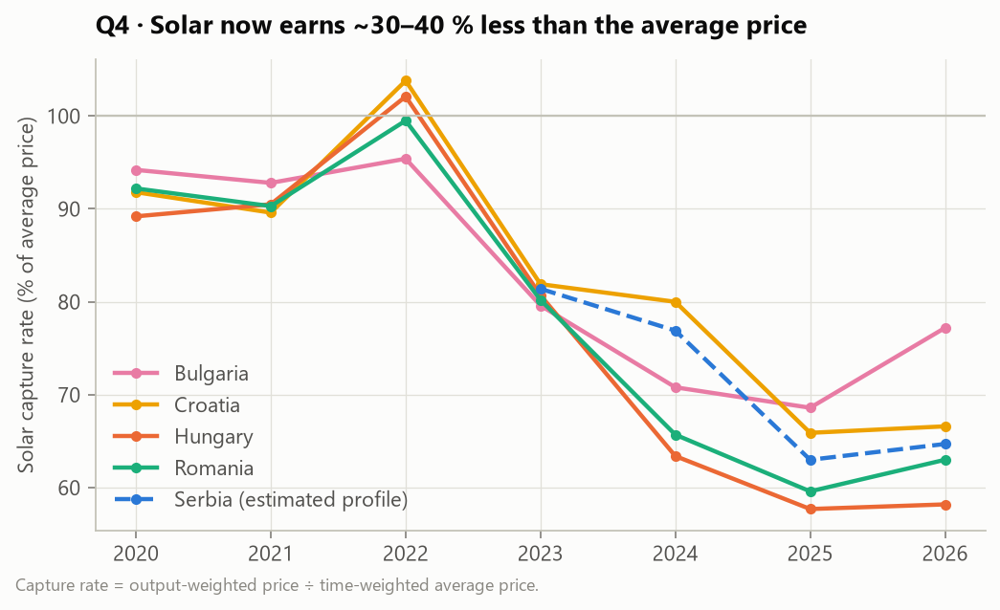

Solar capture rate, % of the average price (Serbia = estimated generation profile):

|   year |   Bulgaria |   Croatia |   Hungary |   Romania | Serbia   |
|-------:|-----------:|----------:|----------:|----------:|:---------|
|   2020 |       94.2 |      91.8 |      89.2 |      92.2 | –        |
|   2021 |       92.8 |      89.6 |      90.5 |      90.3 | –        |
|   2022 |       95.4 |     103.8 |     102.1 |      99.5 | –        |
|   2023 |       79.6 |      81.9 |      80.7 |      80.2 | 81.4     |
|   2024 |       70.8 |      80   |      63.4 |      65.7 | 76.9     |
|   2025 |       68.6 |      65.9 |      57.7 |      59.6 | 63.0     |
|   2026 |       77.2 |      66.6 |      58.2 |      63   | 64.7     |

**Are Serbia's negative prices home-grown or imported?** In 2026 Serbia had **42 negative-price hours**.
In those hours Serbian solar covered only **2.9 %** of demand (estimate).
At least one neighbour was also negative in **39** of them, and all four were in **35**.

**When could Serbia's *own* solar push prices negative?** Hungary's negative prices took off in 2023, when solar reached
**10.4 %** of its annual demand. For Serbia (≈ 34 TWh demand, ≈ 924 kWh/kW) that means
**≈ 3.9 GW** of solar, about 20× today's fleet.

| Scenario                        |   Year Serbia reaches the threshold |
|:--------------------------------|------------------------------------:|
| Linear, +0.12 GW/yr (2025 pace) |                                2056 |
| Linear, +0.5 GW/yr              |                                2033 |
| Linear, +1 GW/yr                |                                2029 |
| Doubling every year             |                                2030 |

**Takeaways**
- Negative prices started in Croatia and Hungary and reached Bulgaria and Romania by 2023. **Serbia's first ones came on 10 May 2026.**
- Long before that, the regional solar boom was already reshaping Serbian prices. Midday used to be ~20 % cheaper than the
  evening (2020–2022). From 2024 it has been **70–80 % cheaper**.
- They are **imported**. Serbia's market is coupled to its neighbours, so when the region has a midday solar glut, the
  price in Serbia falls too, even though Serbian solar barely registers.
- That already hurts Serbian solar investors: the estimated capture rate fell from ~81 % (2023)
  to ~63 % (2025). A Serbian solar plant earns about a third less per MWh than the average price.
- Bulgaria's apparent recovery in 2026 (77 %) is probably a data artefact. Its "solar" series now includes
  evening output sold at high evening prices (see the data-quality note).
- Home-grown negative prices need several GW of domestic solar. Serbia's hydro and its role as a regional
  transit country (flexibility, exports) would push that threshold higher still. These scenarios are illustrations, not forecasts.

---

## Q5 · How much does weather drive solar output?

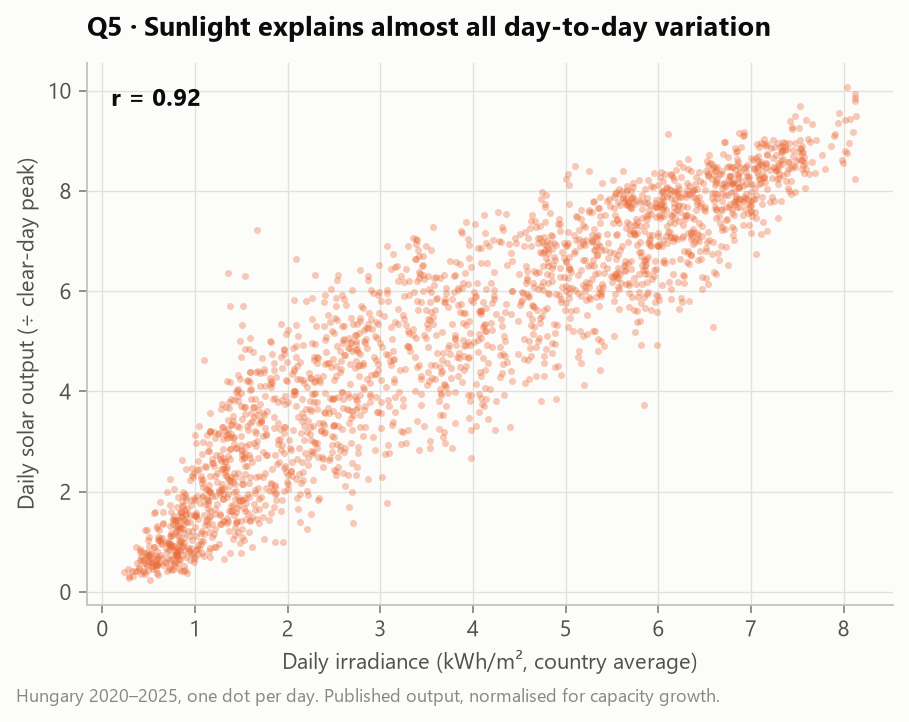

- Correlation of daily output with irradiance: **r = 0.92**. With cloud cover: **r = -0.75**.

| Season   |   Days |   Avg cloud cover % |   r (output vs irradiance) |
|:---------|-------:|--------------------:|---------------------------:|
| Autumn   |    546 |                  58 |                       0.91 |
| Spring   |    552 |                  57 |                       0.89 |
| Summer   |    552 |                  43 |                       0.88 |
| Winter   |    542 |                  68 |                       0.84 |

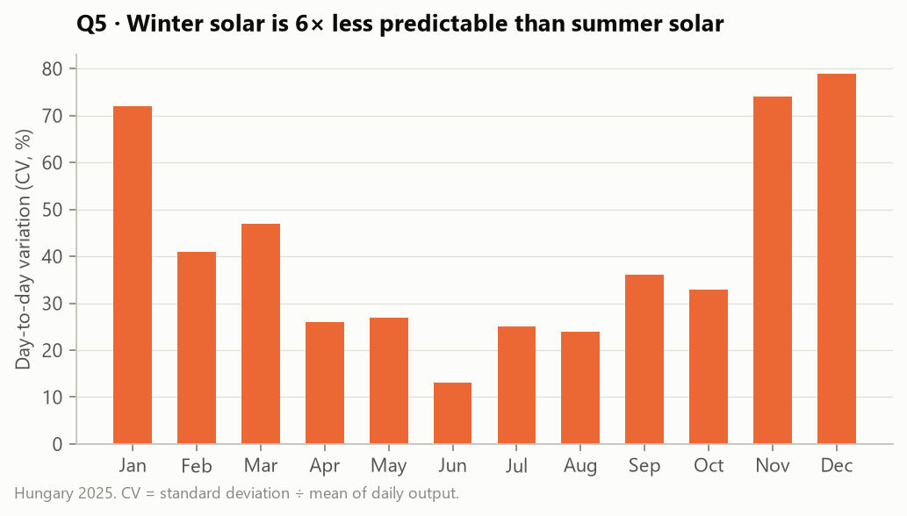

| Month   |   Avg GWh/day |   CV % |   Best ÷ worst day |
|:--------|--------------:|-------:|-------------------:|
| Jan     |           6.3 |     72 |               14.9 |
| Feb     |          13.6 |     41 |               11.8 |
| Mar     |          17.4 |     47 |                8.1 |
| Apr     |          24.3 |     26 |                3.7 |
| May     |          24.2 |     27 |                3.3 |
| Jun     |          32.8 |     13 |                1.6 |
| Jul     |          28.9 |     25 |                3.8 |
| Aug     |          27.6 |     24 |                3.2 |
| Sep     |          20.6 |     36 |                6.9 |
| Oct     |          15.6 |     33 |                4.2 |
| Nov     |           8   |     74 |               16.4 |
| Dec     |           4.5 |     79 |               12.8 |

**Takeaways**
- Irradiance is the whole story. Cloud cover is a weaker proxy, because thin clouds still let a lot of light through.
- In June the best day produces only 1.6× the worst. In November–January it is 13–16×. Winter solar needs
  backup (hydro, imports, storage), and accurate weather forecasts matter most in winter.

---

## Data-quality note · Bulgaria's "solar" after sunset

Solar output should be ~0 when irradiance is zero. For Hungary, Romania and Croatia it is (≤ 0.2 %).
**Bulgaria's published solar series is not, from 2025 onwards:**

| Country   |   Year |   Solar after dark (GWh) |   % of annual solar |   Max after dark (MW) |
|:----------|-------:|-------------------------:|--------------------:|----------------------:|
| bg        |   2023 |                        1 |                 0   |                    21 |
| bg        |   2024 |                       19 |                 0.4 |                    88 |
| bg        |   2025 |                      250 |                 3.9 |                   572 |
| bg        |   2026 |                      772 |                10.3 |                  1440 |

The pattern (≈ 1 GW sustained after sunset in summer 2026) looks like **batteries built next to solar parks and reported as solar**.
That is an assumption, not a confirmed cause. Consequences in this project:
- Bulgarian 2025–2026 data is **excluded from training** the Serbian solar model.
- Bulgaria's 2025–2026 solar share and capture rate are **overstated**. They are shown as published, with this caveat.
